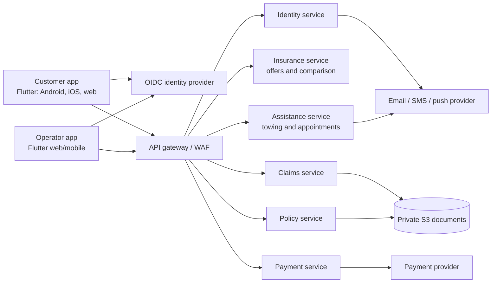
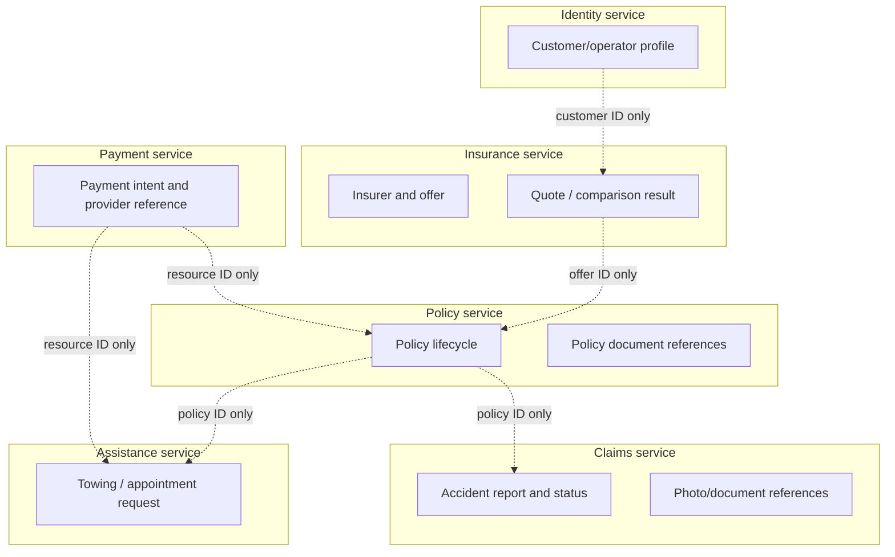

# Emmeny Platform: Initial Architecture

## Scope and assumptions

The repository currently contains only a project-name README and a license; no attachment was available in the workspace. This proposal is therefore a starting point, not a substitute for the missing requirements. Validate the product, insurance intermediary model, and regulatory requirements with Tunisian insurance and legal partners before accepting real customer data or payments.

## Initial decisions

| Area | Initial choice | Reason / decision still needed |
| --- | --- | --- |
| Backend | Java 21, Spring Boot 3.4, Maven multi-module | Familiar ecosystem, typed APIs, independently buildable service modules |
| Frontends | Flutter for the customer and operator apps (Android, iOS, web) | One UI technology across phone and browser; test operator workflows and accessibility on web before committing |
| Service boundaries | Identity, insurance, policy, claims, assistance, payment | Separate business ownership and deployment; keep each service's data private |
| Main database | MongoDB, one logical database per service | Flexible offer, claim, and document metadata; confirm transaction, reporting, and operational needs with a production prototype |
| File storage | Amazon S3 with private buckets and short-lived signed access | Keep scans and accident photos out of MongoDB; add retention and malware-scanning policies |
| Cloud | AWS; evaluate Paris and Milan regions | Select region after residency, latency, partner, and recovery requirements are confirmed |
| Authentication | Amazon Cognito or an equivalent OIDC provider | Keep credentials out of application services; operator access needs stronger MFA and role controls |
| Orchestration | Docker for local development; managed Kubernetes (EKS) only when operationally justified | Avoid starting with Kubernetes overhead before the team has deployment and on-call capacity |
| Observability | OpenTelemetry, CloudWatch, structured JSON logs, metrics and traces | Correlate requests across services without logging customer documents or secrets |

MongoDB is used to honor the non-relational database requirement. It is not automatically the best fit for every workflow: payment settlement, policy issuance, and reporting need explicit consistency and reconciliation designs. Do not store card numbers or security codes; use a PCI-compliant payment provider's hosted/tokenized flow.

## System context

## Service and data ownership

Arrows between services are identifiers and API/event relationships, not shared database collections. Each service owns its schema. Use versioned REST/OpenAPI contracts first; introduce asynchronous events (for example, policy-issued or payment-settled) when workflows need reliable decoupling. Make payment and claim submission operations idempotent.

## Product and access

- Customer flows: browse and compare insurer offers; request help choosing; buy or renew a policy; view contracts and documents; report an accident with photos; request towing or appointments; pay; contact support; and share a user-controlled experience link.
- Visitor flows: provide temporary vehicle and trip details for a quote or short-term cover, with clear eligibility and cross-border coverage terms.
- Operator flows: manage insurer products and offer validity; review customer, policy, claim, and assistance workflows; manage support and appointments; and use auditable role-based access.
- Free, Premium, and Ultra should be represented as server-side entitlements, not UI-only switches. Define limits and included services with insurers before implementation.
- Store language preference per profile and localize all customer-facing strings. Start with Arabic, French, and English; support Arabic right-to-left layouts and Tunisian Arabic content where professionally reviewed.

## Security, compliance, and operations

- Confirm applicable Tunisian insurance distribution/mediation authorization, electronic-signature validity, privacy and cross-border data-transfer rules, and payment-provider requirements with qualified local counsel and partners.
- Encrypt traffic in transit and data at rest; use AWS KMS, Secrets Manager, least-privilege IAM, private networking, MFA for operators, audit trails, rate limits, and documented retention/deletion controls.
- Keep document objects private. Scan uploads, validate type/size, strip unsafe metadata where appropriate, and issue short-lived access links only after authorization.
- Separate production and non-production accounts/environments. Back up databases and object storage; regularly test restore and disaster-recovery procedures.
- Use Kubernetes only after deployment frequency, availability, and team capacity justify it. For an early MVP, managed containers can reduce operational load.
- Define SLOs, alert ownership, incident response, and log redaction before onboarding real customers. Never put tokens, payment details, or document contents in logs.

## AI Assistant and Support Channels

- Treat the assistant and chat/ticket handling as a planned support capability; it is not implemented in the current Java modules.
- Ground answers in versioned, insurer-approved product and policy material. Cite the applicable source and route uncertain or personal coverage questions to an operator.
- The assistant must not bind coverage, approve claims, or present generated text as an insurer decision. Provide a clear human handoff to phone, email, or operator chat.
- Minimize personal data sent to any AI provider. Choose the provider only after privacy, data residency, retention, and cross-border processing are reviewed; never send payment credentials or document contents by default.

## Delivery sequence

1. Validate insurer partnerships, legal operating model, MVP product (start with motor insurance), languages, and payment/signature providers.
2. Deliver a read-only offer catalogue and comparison flow with operator-managed offers.
3. Add identity, quote capture, document storage, and a complete policy purchase path with one insurer.
4. Add claims intake and assistance requests; integrate notifications and support operations.
5. Add payments, more insurers, international visitor coverage, tier entitlements, and analytics after reconciliation and compliance review.

The Java modules in this repository are an initial buildable skeleton with MongoDB document models and local Docker wiring. They do not yet implement APIs, authorization, insurer integrations, digital signatures, or production payment processing.